# 模块拆解与并行 Issue 计划 — Space War

本文档将 V0.1 原型拆解为 **6 个里程碑（`M0`–`M5`）、24 个独立模块 Issue（`SW-01`–`SW-24`）**，专为 **2 人（Dev A 仿真/后端轨 + Dev B 前端/交互轨）并行开发** 编排。

---

## 1. 并行开发路线图

在 `M0` 共建并冻结 `packages/shared` 契约后，两条开发轨道即可完全解耦，仅在 `M1` 结尾（`SW-09`）和 `M5` 结尾（`SW-24`）做里程碑汇合：

```mermaid
flowchart LR
  subgraph M0["M0: 共建共享契约 (1-2天)"]
    SW01["SW-01: Monorepo脚手架 (Shared)"] --> SW02["SW-02: 核心类型与平衡表 (Shared)"] --> SW03["SW-03: 内太阳系星历与遮挡几何 (Shared)"]
  end

  subgraph TrackA["Dev A 轨: 权威仿真与后端 (Headless可独立验证)"]
    SW04["SW-04: 开普勒引擎与三推进器"] --> SW05["SW-05: 转移解算器与Bingo计算"] --> SW06["SW-06: 10Hz引擎与WS房间"]
    SW06 --> SW10["SW-10: 热沉与EMCON模型"] --> SW11["SW-11: 多通道传感与权威迷雾"] --> SW12["SW-12: 电子战与无人机"]
    SW12 --> SW15["SW-15: 统一弹药与远程反导"] --> SW16["SW-16: 激光拦截与数值近战"]
    SW16 --> SW19["SW-19: 采矿与池化自动物流"] --> SW20["SW-20: 母港造船与16槽位奇观"] --> SW22["SW-22: 简单规则测试AI"]
  end

  subgraph TrackB["Dev B 轨: 2D前端与交互 (MockWorldProvider独立开发)"]
    SW07["SW-07: 双精度相机与矢量渲染"] --> SW08["SW-08: Mock数据源与轨道拖拽交互"]
    SW08 --> SW13["SW-13: 本影遮挡与4级航迹图层"] --> SW14["SW-14: EMCON与电子战控制面板"]
    SW14 --> SW17["SW-17: BVR火控与反导交互"] --> SW18["SW-18: 像素精灵与粒子VFX"]
    SW18 --> SW21["SW-21: 物流微调与16槽位奇观HUD"] --> SW23["SW-23: CRT后处理与结算UI"]
  end

  SW03 --> SW04
  SW03 --> SW07
  SW06 --> SW09["SW-09: M1双人联网变轨联调"]
  SW08 --> SW09
  SW22 --> SW24["SW-24: M5 45分钟压测与V0.1验收"]
  SW23 --> SW24
```

---

## 2. Issue 拆解清单（`SW-01` ~ `SW-24`）

### M0：工程脚手架与共享契约（双人共建，1~2 天）

#### `SW-01` Monorepo 脚手架与工具链初始化
- **负责人**：`Shared`
- **前置依赖**：无
- **核心内容**：初始化 `pnpm-workspace.yaml`、`tsconfig.base.json`（strict）、`packages/shared` / `packages/server` / `packages/client` 基础包结构、Vitest、ESLint 与并发启动脚本（`pnpm dev` 同时起后端与 Vite）。
- **验收标准（DoD）**：`pnpm -r build`、`pnpm -r typecheck`、`pnpm -r test` 均能正常跑通占位测试。

#### `SW-02` `packages/shared` 核心领域模型、协议契约与静态平衡配置表
- **负责人**：`Shared`
- **前置依赖**：`SW-01`
- **核心内容**：按架构文档定义 `Vec2`、`KeplerOrbit`、`CelestialBody`、`UnitEntity`、`MunitionEntity`、`SensorTrack`、`LogisticsRoute`、`WonderSlot`、`PlayerCommand` 与 `FactionSnapshot`；建立舰船原型表、弹药表、推进系统表与奇观成本初始配置表。
- **验收标准（DoD）**：前后端共享类型导出完整无循环依赖；静态配置表覆盖 GDD 中所有 9 类单位与 2 类弹药参数。

#### `SW-03` 内太阳系星历模型、时间压缩标尺与天体遮挡/本影几何函数
- **负责人**：`Shared`
- **前置依赖**：`SW-02`
- **核心内容**：录入太阳 + 10 颗天体（水星至健神星，含爱神星）轨道参数及夸大半径；实现 `getBodyStateAt(body, t)`、`isInUmbra(pos, bodies)`、`isOccluded(p1, p2, bodies)`、`getSolarGlareFactor(observerPos, targetPos)` 纯函数。
- **验收标准（DoD）**：1 AU 圆轨道周期严格等于 `252 s`；遮挡与本影几何边界拥有完备 Vitest 单元测试覆盖。

---

### M1：轨道物理引擎 & 2D 态势可视化沙盘（并行核心闭环 1）

#### `SW-04` 二体开普勒轨道引擎与推进系统模型
- **负责人**：`Dev A (后端)`
- **前置依赖**：`SW-03`
- **核心内容**：实现 `stateToOrbit(pos, vel, t)` 与 `orbitToState(orbit, t)`（含 `e < 1e-5` 近圆轨道退化钳位）；实现脉冲点火（化学/核推）与连续微步推力（电推）状态推进及 `deltaV` 扣减，当 `deltaV <= 0` 时锁定为纯惯性滑行。
- **验收标准（DoD）**：无外力演化 10 个公转周期后能量守恒误差 `< 1e-6`；3 种推进系统单测通过。

#### `SW-05` 轨道转移方案解算器与 Bingo Δv 返航余量计算
- **负责人**：`Dev A (后端)`
- **前置依赖**：`SW-04`
- **核心内容**：实现“进入目标轨道”与“交会/拦截目标”双模式解算；输出 `fuel` / `fast` / `stealth`（核推搜遮挡点火窗口、电推慢燃预演、化学双模）三方案与预览轨道；计算目标点返回最近友方补给站的 `bingoDeltaV` 并给出 `safe/amber/red` 分级。
- **验收标准（DoD）**：地火转移 `fuel` 方案耗时接近 3.0 分钟、耗时 `< fast` 方案但更省 Δv；核推隐蔽方案能命中遮挡点火窗口；单次计算耗时 `< 15ms`。

#### `SW-06` 后端固定 Tick 引擎、WebSocket 房间管理与指令管线
- **负责人**：`Dev A (后端)`
- **前置依赖**：`SW-04`, `SW-05`
- **核心内容**：构建 10Hz 固定步长 `SimulationLoop`、`HeadlessMatchRunner`（供无前端压测）、基于 `ws` 的 2P PvP 房间（地球/火星选边、防掉线重连）、命令合法性校验与 `FactionSnapshot` 广播。
- **验收标准（DoD）**：支持两个客户端或自动化测试脚本连接同一房间，下发变轨命令后双方实时接收同步快照。

#### `SW-07` 大地图双精度相机、语义缩放与内太阳系矢量渲染器
- **负责人**：`Dev B (前端)`
- **前置依赖**：`SW-03`
- **核心内容**：实现支持滚轮缩放（0.05 AU 局部交会 ↔ 7 AU 全太阳系）与中键/右键拖拽的双精度平移相机；用 Canvas2D 渲染太阳、10 颗天体夸大圆盘与轨道椭圆线、天体本影阴影扇区、以及语义缩放基础单位矢量标号。
- **验收标准（DoD）**：任意缩放级别下天体与轨道无浮点抖动，60fps 流畅渲染。

#### `SW-08` 前端 Mock 数据源与玩家轨道操控交互
- **负责人**：`Dev B (前端)`
- **前置依赖**：`SW-05`, `SW-07`
- **核心内容**：实现前端 `MockWorldProvider`（无需后端即可启动游戏界面）；实现显式模式切换（`进入轨道` 拖拽调节椭圆 vs `交会拦截` 点选目标）；展示 `节油 / 速度 / 隐蔽` 三方案对比卡片、预览弧线与 Bingo Δv 琥珀/红线确认弹窗。
- **验收标准（DoD）**：在纯前端 Mock 模式下，能选船拖拽目标轨道或点击火星完成交会方案预览、看到 Bingo 警报并执行飞行。

#### `SW-09` M1 端到端联调：双客户端联网操控变轨与交会
- **负责人**：`联调`
- **前置依赖**：`SW-06`, `SW-08`
- **核心内容**：将前端切换至 `WsWorldProvider` 对接 `packages/server`；双方分别操控地球/火星起始舰船向爱神星机动并验证轨道吻合度与网络延迟平滑。
- **验收标准（DoD）**：双浏览器标签页联机下各自变轨指令与服务器结果误差 `< 0.5%`，持续运行 10 分钟无不同步或崩溃。

---

### M2：传感器、隐身与电子战系统（并行核心闭环 2）

#### `SW-10` 飞船热力学模型（热沉、散热片与 EMCON）
- **负责人**：`Dev A (后端)`
- **前置依赖**：`SW-04`
- **核心内容**：实现热沉蓄热与散热方程（推进燃烧、激光发射、基础供电产热；散热片展开按额定速率辐射降温并产生高红外，收起进入 EMCON 静默则热沉持续爬升直至强制紧急排热或过热降效）。
- **验收标准（DoD）**：静默航行热沉满载触发强制散热/降效；核推点火瞬间红外辐射暴增且散热曲线符合配置预期。

#### `SW-11` 多通道传感器与权威战争迷雾引擎
- **负责人**：`Dev A (后端)`
- **前置依赖**：`SW-03`, `SW-10`
- **核心内容**：实现被动 IR、被动光学（含本影归零与迎日眩光）、主动雷达（1/R⁴）与 ESM（1/R²）、短距发散 LADAR；按阵营汇总生成 4 级航迹状态（`bearing` / `uncertain` / `confirmed` / `ghost`），并对目标执行遮挡剔除与航迹持久化衰减。
- **验收标准（DoD）**：服务器下发的 `FactionSnapshot` 经断言检查绝对不包含未探测敌舰真实位置；雷达开机先被敌方远距 ESM 抓到方位线；遮挡区变轨后敌方看到的仍是旧 `ghost` 虚影。

#### `SW-12` 电子战压制与无人机系统
- **负责人**：`Dev A (后端)`
- **前置依赖**：`SW-11`
- **核心内容**：实现主动射频干扰（自身 ESM 暴露但使敌方锁定误差椭圆倍增、打断 `confirmed` 降级为 `uncertain`）、致盲激光短暂压制光学/IR；实现 `drone_recon`（双节点基线视差三角测距收敛 `bearing -> confirmed`）与 `drone_ew`（模拟货船/主力 RCS 与 IR 假信号诱饵或前出干扰）。
- **验收标准（DoD）**：双平台三角测距能在无雷达状态下精确锁定开火热源；开启干扰后敌方锁定误差椭圆显著扩张。

#### `SW-13` 态势感知可视化层（本影、4 级航迹、LADAR 与电子战视觉）
- **负责人**：`Dev B (前端)`
- **前置依赖**：`SW-08`
- **核心内容**：渲染目标周围天体遮挡扇区提示；分样式绘制敌方 4 级航迹（闪烁方位射线、半透明斜线误差椭圆、实线锁定标号+预测轨、虚线 `ghost` 残影+失联计时）；绘制 LADAR 定向扫描锥与受压制噪点圆环。
- **验收标准（DoD）**：使用 `MockWorldProvider` 覆盖测试全部 4 级航迹、遮挡断连变 `ghost` 与干扰噪点效果，视觉层次清晰不遮挡轨道线。

#### `SW-14` 单位控制面板 UI（EMCON / 传感器 / 电子战与无人机）
- **负责人**：`Dev B (前端)`
- **前置依赖**：`SW-13`
- **核心内容**：制作右侧/底部复古终端风格单舰控制面板：热沉温度计条、一键 `静默冷漂` 开关、散热片开关、主动雷达/干扰机开关、LADAR 扇面旋转指向控件、无人机释放按钮。
- **验收标准（DoD）**：面板所有交互能正确发出对应 `PlayerCommand`，并在 Mock/联机下即时反馈状态变化。

---

### M3：BVR 战斗、反导拦截与数值近战（并行核心闭环 3）

#### `SW-15` 统一弹药实体系统与大地图远程反导
- **负责人**：`Dev A (后端)`
- **前置依赖**：`SW-11`, `SW-12`
- **核心内容**：实现共享底层实体 `MunitionEntity`（`light_interceptor` 与 `heavy_torpedo`）；支持飞船向敌方舰船或敌方在飞弹药航迹发射；实现发射后冷漂滑行阶段、末端导引头开机寻的、受电子战压制与诱饵无人机欺骗脱锁的逻辑。
- **验收标准（DoD）**：验证鱼雷冷漂靠近后末段点火命中目标；验证发射拦截弹在大地图成功拦截敌方来袭鱼雷。

#### `SW-16` 短距激光、纯数值近战火炮/近防（CIWS）与子系统损伤
- **负责人**：`Dev A (后端)`
- **前置依赖**：`SW-15`
- **核心内容**：实现短距激光反导与对舰传感器/散热片烧蚀（附带高产热）；实现弹药突防时的数值 CIWS 概率拦截与极近交会时的纯数值近战火炮 DPS 结算；实现 4 子系统（推进/传感/武器/散热）损伤状态对飞船能力的实时降效。
- **验收标准（DoD）**：打坏敌舰散热系统导致其无法开激光与持续点火；护航舰有效提升船队对饱和导弹的 CIWS 生存率。

#### `SW-17` 武器火控交互（齐射、反导指派与交战态势提示）
- **负责人**：`Dev B (前端)`
- **前置依赖**：`SW-14`
- **核心内容**：支持选中我方战舰后右键/快捷键向 `Confirmed` 或 `Uncertain` 航迹规划导弹/鱼雷齐射（可选发数、弹种与是否冷漂）；支持直接框选敌方来袭弹药航迹指派拦截弹；展示激光射程圈与近战交会告警。
- **验收标准（DoD）**：完整完成“探测航迹 → 选弹冷发射 → 指派拦截弹反导”前端交互全流程。

#### `SW-18` 像素精灵与直接像素/粒子 VFX 系统
- **负责人**：`Dev B (前端)`
- **前置依赖**：`SW-07`
- **核心内容**：为天体、母港、空间站与 9 类舰船/弹药绘制高对比度复古像素精灵（随缩放无缝切换矢量标号/像素体）；实现像素级颗粒喷焰（长度与色彩随实时推力和热信号变化）、散热翼泛红、脉冲激光线、CIWS 拦截火星与击毁像素碎片粒子。
- **验收标准（DoD）**：在 50+ 枚同时飞行的弹药与 20+ 艘舰船并发下保持帧率稳定（≥ 50fps）。

---

### M4：强制分层物流、经济循环与奇观胜利（并行核心闭环 4）

#### `SW-19` 天体采矿、太空设施与池化自动物流调度器
- **负责人**：`Dev A (后端)`
- **前置依赖**：`SW-06`, `SW-16`
- **核心内容**：实现矿站采矿产出的周期累加；实施强制建筑地理规则校验（禁止母港采矿、禁止外地建高级工业）；实现运力上限、发货生成/到货消失、货船被毁扣货且永久 `-1` 上限的池化调度；支持 `paused`、`batchSize`、转移模式、`detourWaypoint` 绕路与自动跟车护航。
- **验收标准（DoD）**：测试证明货船被击毁后总运力上限永久减一；设定绕路航点后货船轨迹正确绕开危险区；油船可为漂流友舰补给 Δv。

#### `SW-20` 母港生产队列、开局资产模板与 16 槽位奇观胜利判定
- **负责人**：`Dev A (后端)`
- **前置依赖**：`SW-19`
- **核心内容**：实现母港建造队列（建造新舰、扩容货船上限、打包矿站/中继站套件）；配置“零主力+2初始矿线+辅助舰队”的 5 分钟启动开局模板；实现地球戴森环 / 火星轨道粒子加速器 16 槽位共轨环（同步公转、槽位受袭转入受损停工、耗费 `Ore` 修复、16 槽位满载完工缓冲判定胜利）。
- **验收标准（DoD）**：Headless 脚本可在约 5 分钟时点产出首批作战舰并跨星际转移；任意奇观建成 16/16 且稳态计时结束触发 `winner` 判定。

#### `SW-21` 物流航线管理 UI、母港建造面板与 16 槽位奇观环 HUD
- **负责人**：`Dev B (前端)`
- **前置依赖**：`SW-17`, `SW-18`
- **核心内容**：制作物流航线管理抽屉（一键暂停、单/编队发车切换、拖拽设置深空绕路航点、绑定护航舰）；制作母港生产队列与资源/运力顶栏；在星图上渲染围绕地球/火星母港共轨的 16 个奇观槽位状态节点（空/施工/完工/受损停工）。
- **验收标准（DoD）**：玩家能在 3 次点击内完成一条矿线的绕路与护航绑定；奇观 16 个槽位随母港同步公转且状态清晰可读。

---

### M5：测试 AI、PvP 体验与 CRT 风格打磨

#### `SW-22` 简单规则测试 AI
- **负责人**：`Dev A (后端)`
- **前置依赖**：`SW-20`
- **核心内容**：实现单人调试与冒烟测试用规则 AI：自动抢占最近外围高产天体建矿站、维持货船运力、周期性生产侦察+护航+破交编队向敌方航线或爱神星巡逻、在遭遇攻击时启动热沉/护航反击，并将盈余资源投入己方 16 槽位奇观。
- **验收标准（DoD）**：单人模式下 AI 能完整跑通开局、扩矿、破交与奇观施工流程，不产生死循环或非法指令异常。

#### `SW-23` 复古 CRT 视觉后处理、音效占位与全局结算界面
- **负责人**：`Dev B (前端)`
- **前置依赖**：`SW-21`
- **核心内容**：实现可开关的复古 CRT 屏幕扫描线、轻微荧光辉光（Bloom）与边缘暗角效果；接入少量 Web Audio 合成态提示音（导弹来袭警报、雷达锁定滴声、激光脉冲）；完成胜负结算面板与大厅开房/选边（地球/火星/人机）界面。
- **验收标准（DoD）**：CRT 滤镜不影响文字与小字号 Δv 读数清晰度（并提供关闭开关）；大厅开房到结算界面全链路闭环。

#### `SW-24` 45 分钟完整对局联机压测、平衡性初调与 V0.1 里程碑验收
- **负责人**：`联调`
- **前置依赖**：`SW-22`, `SW-23`
- **核心内容**：双人实际打满至少 2 局完整联机 PvP（与 1 局加速对 AI 回归）；微调矿产速率、舰船造价、Δv 上限、导弹成本与传感器距离，确保 5 分钟能出击、~45 分钟进入奇观或封锁决胜；产出 V0.1 试玩复盘。
- **验收标准（DoD）**：全程联机无断线状态错乱；确认“5 分钟破冰开战 + 45 分钟破交与奇观分胜负”核心循环成立。

---

## 3. GitHub Issues 导入建议标签体系

在团队确认文档无误后，可使用 `gh label create` 与 `gh issue create` 批量导入上述 24 个任务，建议配置如下标签：

- **开发轨道**：`track:shared`、`track:backend`、`track:frontend`、`type:sync`（联调汇合点）
- **里程碑**：`milestone:M0`、`milestone:M1`、`milestone:M2`、`milestone:M3`、`milestone:M4`、`milestone:M5`
- **系统领域**：`area:physics`、`area:sensor-ew`、`area:combat`、`area:logistics`、`area:ui-vfx`、`area:ai`
